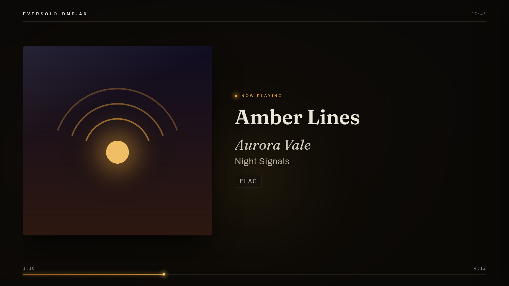
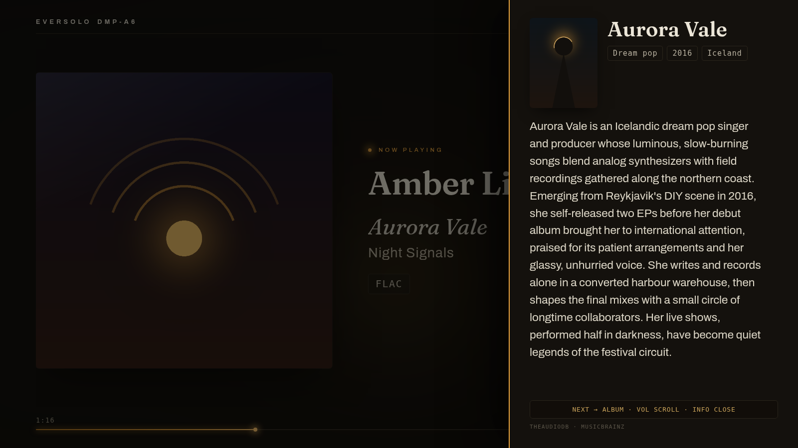
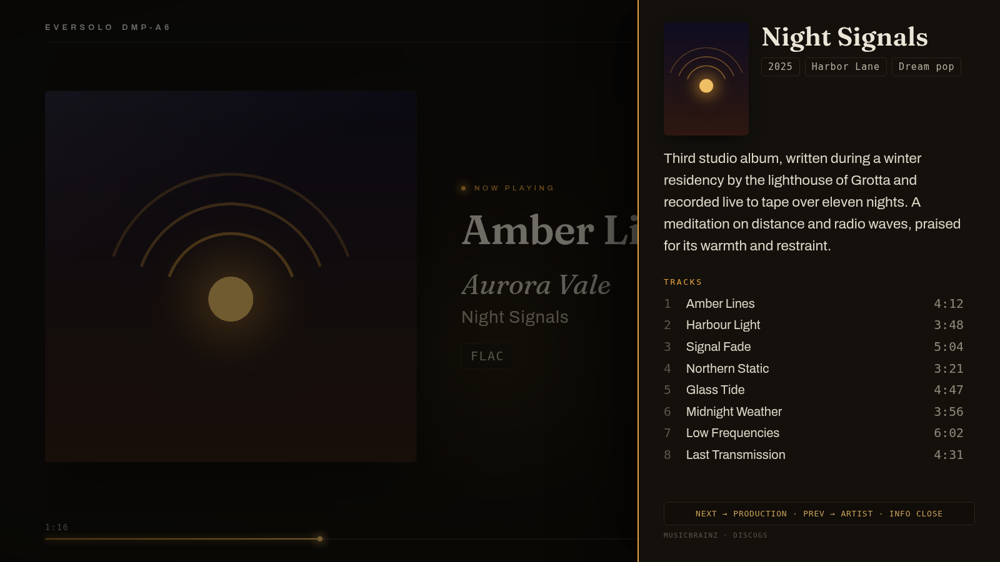
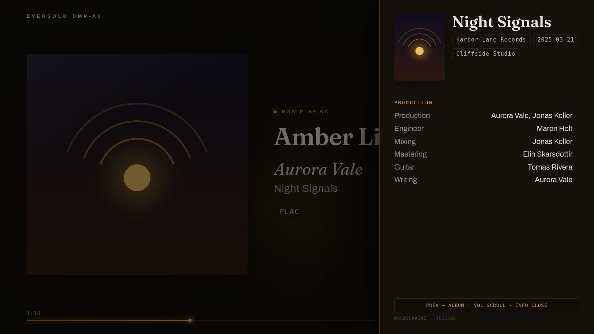

# eversolo-screen

Now-Playing-Anzeige für Eversolo-Streamer (DMP-A6, A8, A10) auf Raspberry Pi + HDMI-Bildschirm. Cover, Titel, Audioqualität, Künstlerbiografien und Produktions-Credits, gesteuert per Infrarot-Fernbedienung.

[Français](README.md) · [English](README.en.md) · [Español](README.es.md)



| Künstlerseite | Albumseite | Produktionsseite |
|---|---|---|
|  |  |  |

*Oberfläche hier auf Englisch, verfügbar auf Französisch, Englisch, Spanisch und Deutsch.*

## Funktionen

- Cover, Titel, Künstler, Album, Fortschritt, Uhr, Farbstimmung aus dem Cover
- Audioqualität: Abtastrate, Bittiefe, Bitrate (reale Eversolo-Formate)
- Info-Panel mit 3 Seiten: Künstlerbiografie, Album (Beschreibung, Titel, Laufzeiten), Produktion (Credits, Label, Studios)
- Lernende Infrarot-Fernbedienung: 7 Aktionen mit jeder beliebigen Fernbedienung koppelbar
- Optionaler Infrarot-Sender: der Pi lernt Befehle und sendet sie an TV oder Verstärker
- Kiosk-Modus beim Start, passwortgeschützte Verwaltung
- 4 Sprachen: Französisch, Englisch, Spanisch, Deutsch
- Aktualisierung mit einem Klick aus der Oberfläche

## Hardware

| Element | Minimum | Empfohlen |
|---|---|---|
| Raspberry Pi | Pi 3 | Pi 4, 2 GB |
| SD-Karte | 16 GB | Klasse A1 |
| Netzteil | | Offizielles Raspberry |
| Netzwerk | WLAN | Ethernet |
| IR-Empfänger (optional) | VS1838B oder TSOP38238 | |
| IR-LED (optional) | 940-nm-LED + 220-Ω-Widerstand | KY-005-Modul |

Der Eversolo wird über das Netzwerk gesteuert (API Port 9529): kein Sensor am Streamer nötig.

## Installation

### Automatisch (empfohlen)

1. Raspberry Pi Imager: Raspberry Pi OS Lite 64 Bit, SSH aktiviert, Passwort-Authentifizierung
2. Karte noch eingehängt:

```bash
curl -O https://raw.githubusercontent.com/kofekod23/eversolo-screen/main/tools/prepare-sd.sh
bash prepare-sd.sh
```

3. Pi starten. Nach 10 bis 15 Minuten `http://PI_IP:8080` öffnen und den am Fernseher angezeigten Code eingeben: der Assistent erkennt den Eversolo und legt das Admin-Passwort an.

### Manuell (SSH)

```bash
sudo apt update && sudo apt install -y git
git clone https://github.com/kofekod23/eversolo-screen.git
cd eversolo-screen && ./install.sh --kiosk --ir
sudo reboot
```

Kombinierbare Optionen: `--kiosk` (TV-Anzeige), `--ir` (Fernbedienungs-Empfänger), `--ir-tx` (Sender), `--ram` (Protokolle und Caches im RAM, schont die SD-Karte).

## Fernbedienung

`http://PI_IP:8080/remote`: Verkabelungsschema des Sensors, Erkennungsanzeige, Live-Test, Kopplung der 7 Aktionen. Bei offenem Info-Panel blättern die Lautstärketasten den Text, die Titeltasten wechseln die Seiten.

## Datenquellen

| Daten | Quellen |
|---|---|
| Identität von Künstler und Album | MusicBrainz (das laufende Album löst Namensgleichheiten auf) |
| Biografien | TheAudioDB, Last.fm, Wikipedia über Wikidata |
| Titel, Credits, Studios | MusicBrainz, Discogs, Genius (laufender Titel) |

Alles funktioniert ohne Schlüssel. Die folgenden Schlüssel sind kostenlos; in `/config` eingetragen, ergänzen sie Biografien und Credits.

| Dienst | Was er beiträgt | Wo es den Schlüssel gibt |
|---|---|---|
| Last.fm | Künstlerbiografien, Albumbeschreibungen | [API-Konto anlegen](https://www.last.fm/api/account/create) (Name und Beschreibung frei, Callback-URL leer). Vorhandene Schlüssel: [last.fm/api/accounts](https://www.last.fm/api/accounts). „API key“ kopieren, nicht „Shared secret“. |
| Discogs | Ausführliche Credits: Produktion, Mischung, Studios | [Settings > Developers](https://www.discogs.com/settings/developers), Schaltfläche „Generate new token“. |
| Genius | Credits des laufenden Titels, nützlich bei neuen Veröffentlichungen | [genius.com/api-clients](https://genius.com/api-clients): „New API Client“ (Name und Website frei), dann „Generate Access Token“. Den „Client Access Token“ kopieren. |
| TheAudioDB | Biografien und Fotos | Standardmäßig wird der kostenlose Schlüssel `123` verwendet. Ein persönlicher Schlüssel (Premium-Abo) steht in Ihrem Profil; siehe [theaudiodb.com/free_music_api](https://www.theaudiodb.com/free_music_api). |

## Aktualisierung

Wenn eine Version veröffentlicht wird, zeigt `/config` die Neuerungen und eine Schaltfläche zum Installieren (nicht während der Wiedergabe). Per SSH erledigt `./update.sh` dasselbe.

Jede Version wird in einem eigenen Ordner (`~/eversolo-versions`) installiert, und nur wenn ihre Signatur zum bei der Installation auf dem Pi hinterlegten Schlüssel passt. Startet die neue Version nicht, kehrt der Pi von selbst zur vorherigen zurück; eine Schaltfläche in `/config` erlaubt das ebenfalls. Einstellungen und Passwort bleiben in `~/eversolo-screen`.

## Lizenz

[CC BY-NC-SA 4.0](LICENSE.en.md): freie Nutzung und Änderung, Verkauf und Monetarisierung untersagt ([offizielle deutsche Fassung](https://creativecommons.org/licenses/by-nc-sa/4.0/deed.de)).

## Fehlerbehebung

Ausführliche Anleitung (Französisch): [INSTALL.md](INSTALL.md). Passwort vergessen: `venv/bin/python tools/motdepasse.py`.
