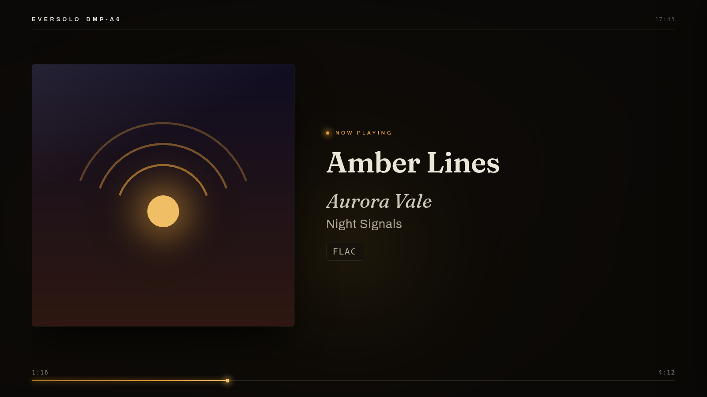
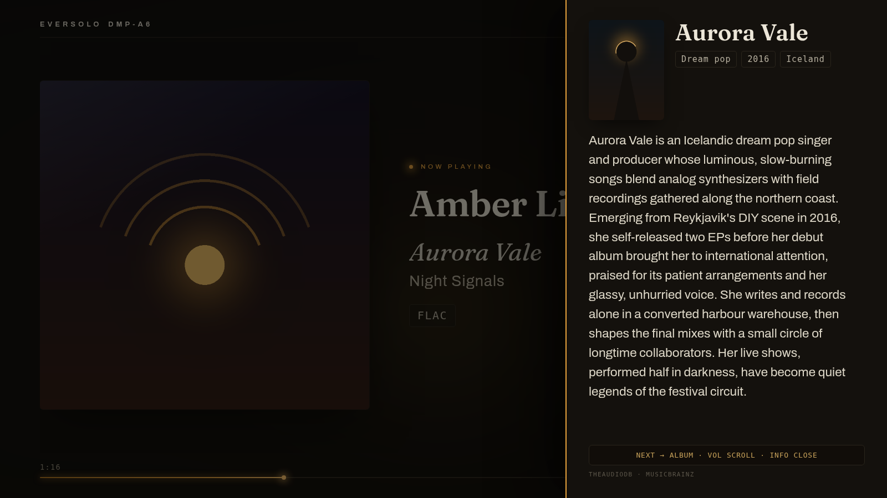
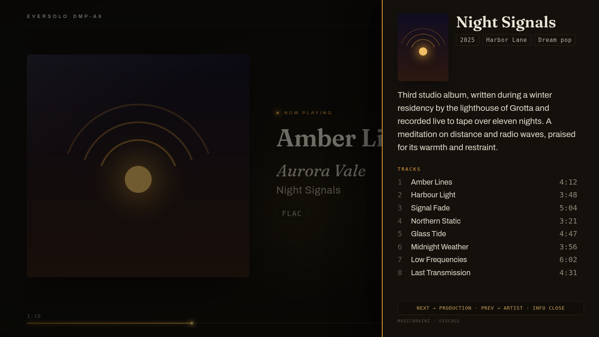
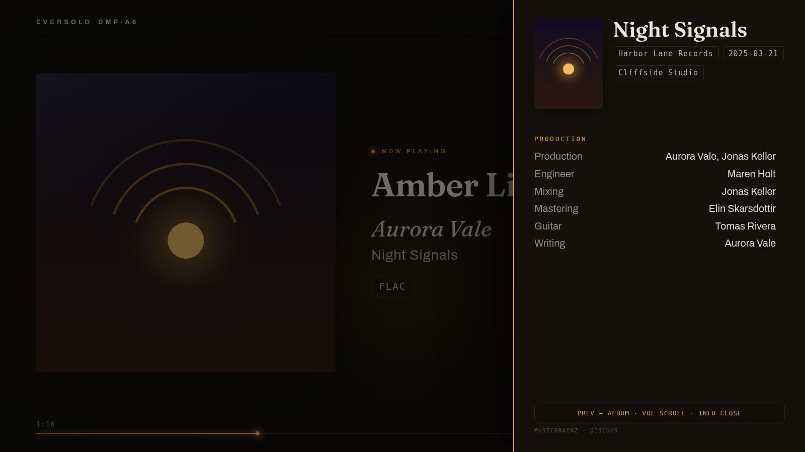
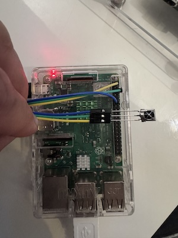

# eversolo-screen

Affichage « now playing » pour streamers Eversolo (DMP-A6, A8, A10) sur Raspberry Pi + écran HDMI. Pochette, titre, qualité audio, biographies d'artistes et crédits de production, pilotés à la télécommande infrarouge.

[English](README.en.md) · [Español](README.es.md) · [Deutsch](README.de.md)



| Page artiste | Page album | Page production |
|---|---|---|
|  |  |  |

*Interface montrée en anglais, disponible en français, anglais, espagnol et allemand.*

## Fonctionnalités

- Pochette, titre, artiste, album, progression, horloge, ambiance colorée tirée de la pochette
- Qualité audio en pastilles : fréquence, profondeur, débit (formats Eversolo réels gérés, virgule française comprise)
- Volet infos sur 3 pages : biographie de l'artiste, album (description, plages, durées), production (crédits, label, studios)
- Télécommande infrarouge par apprentissage : 7 actions appairables avec n'importe quelle télécommande
- Émetteur infrarouge optionnel : le Pi apprend et réémet des commandes vers TV ou ampli
- Kiosque automatique au démarrage, interface d'administration protégée par mot de passe
- 4 langues : français, anglais, espagnol, allemand
- Mise à jour en un clic depuis l'interface

## Matériel

| Élément | Minimum | Conseillé |
|---|---|---|
| Raspberry Pi | Pi 3 | Pi 4, 2 Go |
| Carte SD | 16 Go | Classe A1 |
| Alimentation | | Officielle Raspberry |
| Réseau | Wi-Fi | Ethernet |
| Capteur IR (optionnel) | VS1838B ou TSOP38238 | |
| LED IR (optionnel) | LED 940 nm + résistance 220 Ω | Module KY-005 |


<div align="center">

|  |
| :---: |

</div>


L'Eversolo est piloté par le réseau (API port 9529) : aucun capteur requis sur le streamer.

## Installation

### Automatique (recommandée)

1. Raspberry Pi Imager : Raspberry Pi OS Lite 64 bits, SSH activé, authentification par mot de passe
2. Carte encore dans l'ordinateur :

```bash
curl -O https://raw.githubusercontent.com/kofekod23/eversolo-screen/main/tools/prepare-sd.sh
bash prepare-sd.sh
```

3. Démarrer le Pi. Après 10 à 15 minutes, ouvrir `http://IP_DU_PI:8080` et saisir le code affiché sur la TV : l'assistant détecte l'Eversolo et crée le mot de passe administrateur.

### Manuelle (SSH)

```bash
sudo apt update && sudo apt install -y git
git clone https://github.com/kofekod23/eversolo-screen.git
cd eversolo-screen && ./install.sh --kiosk --ir
sudo reboot
```

Options cumulables : `--kiosk` (affichage TV), `--ir` (récepteur télécommande), `--ir-tx` (émetteur), `--ram` (journaux et caches en RAM, ménage la carte SD).

## Télécommande

`http://IP_DU_PI:8080/remote` : schéma de câblage du capteur, voyant de détection, test en direct, appairage des 7 actions (lecture/pause, plages, volume, muet, infos). Volet infos ouvert : les touches volume défilent le texte, les touches de plage tournent les pages.

## Sources de données

| Donnée | Sources |
|---|---|
| Identité artiste et album | MusicBrainz (l'album en cours lève les homonymies) |
| Biographies | TheAudioDB, Last.fm, Wikipédia via Wikidata |
| Plages, crédits, studios | MusicBrainz, Discogs, Genius (plage en cours) |

Tout fonctionne sans clé. Les clés ci-dessous sont gratuites ; collées dans `/config`, elles ajoutent des biographies et des crédits.

| Service | Ce qu'il apporte | Où trouver la clé |
|---|---|---|
| Last.fm | Biographies d'artistes, descriptions d'albums | [Créer un compte API](https://www.last.fm/api/account/create) (nom et description au choix, URL de rappel vide). Vos clés existantes : [last.fm/api/accounts](https://www.last.fm/api/accounts). Copiez « API key », pas « Shared secret ». |
| Discogs | Crédits détaillés : production, mixage, studios | [Settings > Developers](https://www.discogs.com/settings/developers), bouton « Generate new token ». |
| Genius | Crédits de la plage en cours, utiles pour les sorties récentes | [genius.com/api-clients](https://genius.com/api-clients) : « New API Client » (nom et adresse de site au choix), puis « Generate Access Token ». Copiez le « Client Access Token ». |
| TheAudioDB | Biographies et photos | Clé gratuite `123` utilisée par défaut. Une clé personnelle (abonnement Premium) figure sur votre profil ; détails sur [theaudiodb.com/free_music_api](https://www.theaudiodb.com/free_music_api). |

## Mise à jour

Quand une version est publiée, `/config` affiche ses nouveautés et un bouton pour l'installer (pas pendant la lecture). En SSH, `./update.sh` fait la même chose.

Chaque version s'installe dans son propre dossier (`~/eversolo-versions`) et seulement si sa signature correspond à la clé enregistrée sur le Pi à l'installation. Si la nouvelle version ne démarre pas, le Pi revient tout seul à la précédente ; un bouton de `/config` permet aussi d'y revenir. Réglages et mot de passe restent dans `~/eversolo-screen`.

Pour publier une version signée : `tools/publier-version.sh v1.2.0 "nouveauté" "autre nouveauté"`.

## Licence

[CC BY-NC-SA 4.0](LICENSE.md) : usage et modification libres, vente et monétisation interdites.

## Dépannage

Guide détaillé pas à pas : [INSTALL.md](INSTALL.md). Mot de passe oublié : `venv/bin/python tools/motdepasse.py`.
